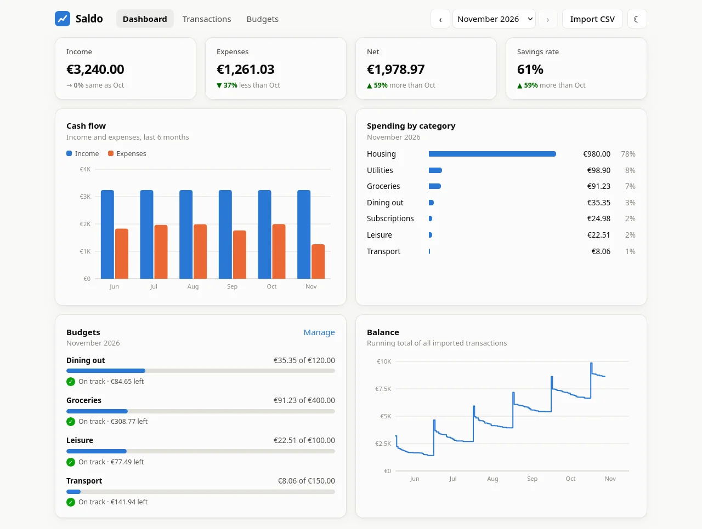

# Saldo

[](https://github.com/nvmchris/finance-dashboard/actions/workflows/ci.yml)
[](LICENSE)

A private, offline-first personal finance dashboard. Import your bank statements as CSV,
let Saldo categorise them, set monthly budgets and see where your money goes. Nothing
leaves your browser — there is no server, no account and no tracking.

<picture>
  <source media="(prefers-color-scheme: dark)" srcset="docs/screenshot-dark.webp" />
  
</picture>

## Features

- **CSV import that copes with real bank exports** — detects the delimiter and columns,
  reads German (`1.234,56`, `31.12.2026`) and English (`1,234.56`, `12/31/2026`) formats,
  separate debit/credit columns, and skips rows it has already imported.
- **Automatic categories** — keyword rules sort transactions into groceries, housing,
  subscriptions and more; fix any of them with one click.
- **Dashboard** — income, expenses, net and savings rate with month-over-month change,
  six months of cash flow, ranked spending by category and a running balance.
- **Budgets** — a monthly limit per category with on-track, close and over-budget states.
- **Transactions** — search, filter, sort, edit, add manually and export back to CSV.
- **Settings** — pick a currency, add your own category rules, back up and restore
  everything as a JSON file.
- **Light and dark theme**, keyboard accessible, charts readable with colour-vision
  deficiency and by screen readers.
- **No chart library** — the charts are small SVG components; React is the only runtime
  dependency.

## Getting started

Requires Node.js 20.19 or newer.

```bash
npm install
```

```bash
npm run dev
```

Open the printed URL and click **Load demo data**, or import a CSV file. Append `?demo`
to the URL to explore sample data without touching what is saved in your browser.

The dev server honours `PORT` and `HOST`. The app also launches from
[project-hub](https://github.com/nvmchris/project-hub).

### CSV format

Saldo needs a header row with a date, a description and an amount. Common German and
English column names are recognised:

| Column      | Recognised names (examples)                                        |
| ----------- | ------------------------------------------------------------------ |
| Date        | `Date`, `Datum`, `Buchungstag`, `Valuta`                           |
| Description | `Description`, `Verwendungszweck`, `Buchungstext`, `Payee`         |
| Amount      | `Amount`, `Betrag`, `Umsatz` — or `Debit`/`Credit`, `Soll`/`Haben` |

```csv
Buchungstag;Verwendungszweck;Betrag
01.03.2026;Gehalt März;3.240,00
02.03.2026;REWE Markt;-45,10
```

## Scripts

| Command             | What it does                    |
| ------------------- | ------------------------------- |
| `npm run dev`       | Start the dev server            |
| `npm run build`     | Type-check and build to `dist/` |
| `npm test`          | Run the test suite once         |
| `npm run lint`      | Lint with ESLint                |
| `npm run typecheck` | Type-check without emitting     |
| `npm run format`    | Format with Prettier            |

## Project structure

```
src/
  lib/          Pure logic: CSV parsing, categorisation, statistics, budgets, storage
  state/        Reducer and store (React context, persisted to localStorage)
  components/   Views and UI; charts/ holds the SVG charts
  hooks/        Theme, element width and notices
```

Amounts are stored as integer cents, dates as ISO strings. All business logic lives in
`src/lib` and is covered by unit tests; the views are tested through the rendered app.

## Privacy

Your data is stored in `localStorage` under the key `saldo:data:v1` and never sent
anywhere. Clearing site data removes it.

## License

[MIT](LICENSE)

Owner: nvmchris
